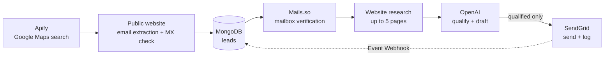

# AI Outreach Pipeline

Find businesses on Google Maps, verify their public email addresses, research
each company's website, and send a short cold email grounded in what the site
actually says. Only companies with real evidence of a fit get an email.

Built with NestJS, MongoDB, Apify, Mails.so, the OpenAI Responses API, and SendGrid.



## What makes it different

- **Evidence or no email.** The model must cite pages it was given. It scores
  the fit from 0 to 100, and a lead that lacks evidence is rejected instead of
  getting a generic pitch. The prompt forbids invented problems, metrics, or
  claims about channels the company uses.
- **One send per address, guaranteed.** Each recipient is claimed with an atomic
  conditional update before SendGrid is called. Concurrent campaigns cannot
  double-send, and idempotency keys make retries safe.
- **Every send is auditable.** The exact subject, text, HTML, sender, and
  recipient are stored in `outreach_email_logs` *before* SendGrid is called.
- **Opt-outs stick.** Unsubscribes, spam reports, and bounces from the
  SendGrid Event Webhook are applied automatically. A suppressed address stays
  suppressed even if a later scrape finds it again.
- **18 locales.** English (13 markets), Mexican Spanish, Vietnamese, Thai,
  French, and German, each with a natively written footer.
- **Safe scraping.** Website fetches resolve only to public IP addresses, which
  are checked on every connection and redirect, so scraped URLs cannot reach
  internal networks or cloud metadata endpoints.

## Quick start

Requires Node.js 22+ and MongoDB.

```bash
npm install
cp .env.example .env     # fill in the keys and your sender identity
npm test
npm run build && npm start
```

Every endpoint except the SendGrid webhook requires the header
`x-api-key: $OUTREACH_API_KEY`.

## Configuration

See [.env.example](.env.example) for every variable. The main groups:

| Group | Variables | Used for |
|---|---|---|
| Sender identity | `OUTREACH_SENDER_NAME`, `OUTREACH_SENDER_TITLE`, `OUTREACH_COMPANY_NAME`, `OUTREACH_COMPANY_DESCRIPTION`, `OUTREACH_REPLY_TO`, `OUTREACH_COMPANY_WEBSITE`, `OUTREACH_BOOKING_URL`, `OUTREACH_COMPANY_ADDRESS` | Email footer, reply-to, and the AI prompt |
| Discovery | `APIFY_TOKEN` | Google Maps search |
| Verification | `MAILS_API_KEY` | Mailbox checks |
| Drafting | `OPENAI_API_KEY`, `OPENAI_OUTREACH_MODEL` | Qualification and email text |
| Sending | `SENDGRID_API_KEY`, `SENDGRID_FROM_EMAIL`, `SENDGRID_FROM_NAME`, `SENDGRID_ASM_GROUP_ID`, `SENDGRID_WEBHOOK_PUBLIC_KEY` | Delivery and provider events |

Set a translated job title with `OUTREACH_SENDER_TITLE_<LOCALE>`, for example
`OUTREACH_SENDER_TITLE_DE_DE=Vertriebsberater`. Put the address on one line and
separate its lines with `|`. Quote it if it contains `#`.

## Usage

### 1. Import leads

```bash
curl -X POST http://localhost:3000/lead-imports/apify \
  -H "x-api-key: $OUTREACH_API_KEY" -H "content-type: application/json" \
  -d '{
    "searchTerms": ["dental clinic"],
    "locations": ["Kuala Lumpur, Malaysia"],
    "maxPlacesPerSearch": 100
  }'
```

This returns `202` with a job ID. Poll it with `GET /lead-imports/:jobId`. To
reuse completed (already paid-for) Apify runs, pass `"runIds": [...]` instead
of search terms.

Leads are stored before verification, so verification can be retried without
paying for another scrape. You can also import an existing Apify JSON export:

```bash
npm run import:leads -- ./verified_business_leads.json
```

### 2. Preview, test, and send personalised outreach

```bash
# Research the site and generate a draft (nothing is sent)
curl -X POST http://localhost:3000/leads/LEAD_ID/outreach \
  -H "x-api-key: $OUTREACH_API_KEY" -H "content-type: application/json" \
  -d '{"mode":"preview","outreachType":"conversational_agent","locale":"en-GB"}'

# Send the draft to your own inbox instead of the lead
curl -X POST http://localhost:3000/leads/LEAD_ID/outreach/test \
  -H "x-api-key: $OUTREACH_API_KEY" -H "content-type: application/json" \
  -d '{"to":"you@yourcompany.com"}'

# Send it to the lead
curl -X POST http://localhost:3000/leads/LEAD_ID/outreach \
  -H "x-api-key: $OUTREACH_API_KEY" -H "content-type: application/json" \
  -d '{"mode":"send"}'
```

`outreachType` selects the campaign angle:

| Type | Pitches | Qualifies when the site shows |
|---|---|---|
| `general_ai` | One concrete AI improvement | A specific process (no minimum fit score) |
| `conversational_agent` | An enquiry, booking, or support agent | A customer-facing conversation workflow |
| `engineering_partner` | White-label engineering capacity | Software, IT, or digital-product delivery |
| `restaurant_digital` | Ordering, reservations, loyalty | A food-service business with a real opportunity |
| `sme_digital` | A vertical-specific digital workflow | Clinics, property, home services, education, logistics, hospitality, automotive, B2B supply |

Apart from `general_ai`, every type qualifies only at a fit score of 65 or
above. The application always appends the call to action, signature, postal
address, and opt-out line, so the model can never change them. Subjects get an
`<ADV>` prefix.

To process many leads, save a `GET /leads` response to a file and run:

```bash
OUTREACH_API_KEY=... OUTREACH_TYPE=sme_digital OUTREACH_LOCALE=en-MY \
  npm run outreach:batch -- preview leads.json   # then: send
```

The batch runner picks one address per company, preferring `sales@` and
`info@`. It skips addresses such as `support@`, `hr@`, and `noreply@`, and
writes a report to `reports/`.

### 3. Template campaigns

To send a SendGrid dynamic template to every eligible lead:

```bash
curl -X POST http://localhost:3000/email-campaigns \
  -H "x-api-key: $OUTREACH_API_KEY" -H "content-type: application/json" \
  -d '{"templateId":"d-xxxx","limit":500,"idempotencyKey":"spring-2026"}'
```

Templates receive `personName`, `companyName`, and `clinic_name` (the company
name with `&` replaced, for safe use in subject lines). To send one template to
yourself, use `POST /email-campaigns/test`. [templates/](templates/) contains
an example HTML template.

### 4. Opt-outs and provider events

```bash
# Someone replied "unsubscribe"
curl -X POST http://localhost:3000/unsubscribes \
  -H "x-api-key: $OUTREACH_API_KEY" -H "content-type: application/json" \
  -d '{"email":"info@their-company.com"}'
```

To set up the Event Webhook in SendGrid (Mail Settings → Event Webhook):

1. Point it at `https://your-host/webhooks/sendgrid`.
2. Enable **Signature Verification** and copy the public key into
   `SENDGRID_WEBHOOK_PUBLIC_KEY`. The endpoint rejects all requests until this
   is set.

| Event | Effect |
|---|---|
| `unsubscribe`, `group_unsubscribe`, `spamreport` | Lead suppressed permanently |
| `bounce` | Delivery `bounced` (or `blocked`) |
| `dropped` | Delivery `blocked` |
| `delivered` | Delivery `delivered` |

### Inspecting data

`GET /leads`, `GET /leads/:id`, `GET /email-logs`, and `GET /email-logs/:id`.
The list endpoints filter by status, country, run, recipient, outreach type,
and locale. `limit` is capped at 200.

## Statuses

**Verification**

- **`valid`:** sendable.
- **`unknown`:** sendable. Mails.so checked the mailbox but could not confirm it.
- **`risky`:** not sendable (catch-all).
- **`invalid`:** not sendable.
- **`pending`:** not yet checked.
- **`failed`:** the check itself did not complete because of a provider outage
  or a missing result. These leads are never sent. Re-check them with
  `POST /lead-verifications/retry`.

**Delivery:** `not_queued → queued → sending → sent → delivered | bounced | blocked`,
or `failed`. Only `not_queued` leads are ever selected, so no address receives
the same campaign twice. `sent` means SendGrid accepted the message; the
webhook moves it on from there.

## Operational notes

- **Single instance only.** Jobs run in-process. On startup the server releases
  leads that were claimed but never attempted. It marks interrupted sends
  `failed` rather than retrying them, because they may have reached SendGrid.
  Before running more than one instance, move jobs to a durable queue such as
  BullMQ or SQS.
- **Data stays out of git.** `.gitignore` excludes `.env`, spreadsheets,
  `reports/`, and send results, because they contain real people's addresses.

## Compliance

Cold email is regulated, and the rules differ by country. Some examples:

- **US:** CAN-SPAM.
- **UK:** PECR plus UK GDPR. Sole traders and partnerships need prior consent.
- **EU:** GDPR plus national rules. Germany's UWG effectively requires consent
  even for business-to-business email.
- **Singapore:** the Spam Control Act.

This project includes the mechanics that compliant sending needs: a
physical address, a working opt-out with suppression, `<ADV>` labelling,
evidence-based targeting of business role addresses, and a full send log.
**Whether a given campaign is lawful is the sender's responsibility.** Check
the rules for each market you target before sending.

## Spreadsheet CLI

The original mailer is still available. It sends a SendGrid template to the
rows of an `.xlsx` or `.csv` file with `email`, `company`, and `name` columns:

```bash
npm run mail -- ./recipients.xlsx          # dry run
npm run mail -- ./recipients.xlsx --send   # uses SENDGRID_TEMPLATE_ID
```

## License

[MIT](LICENSE)
